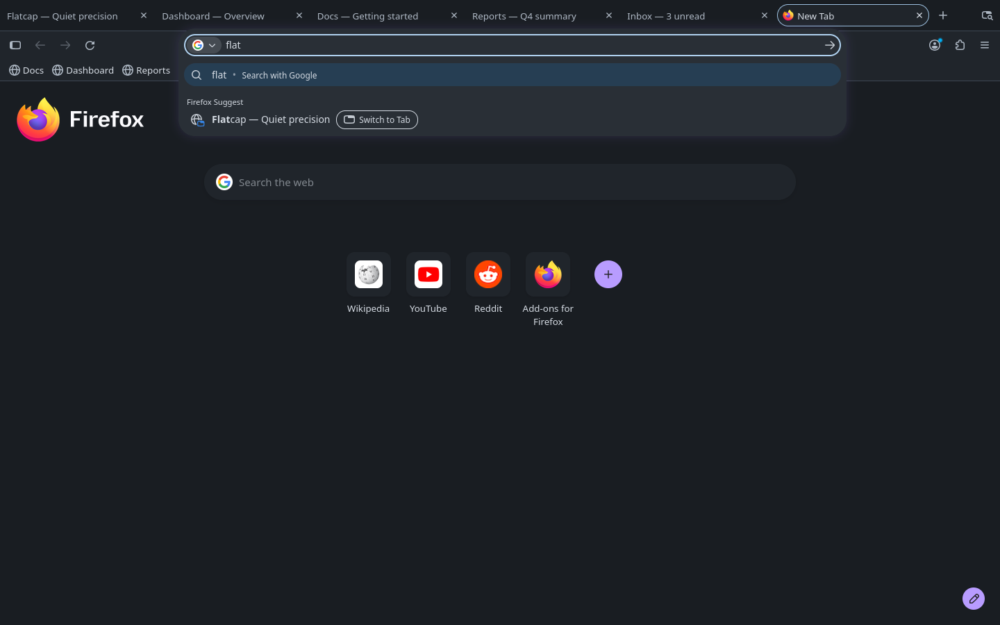
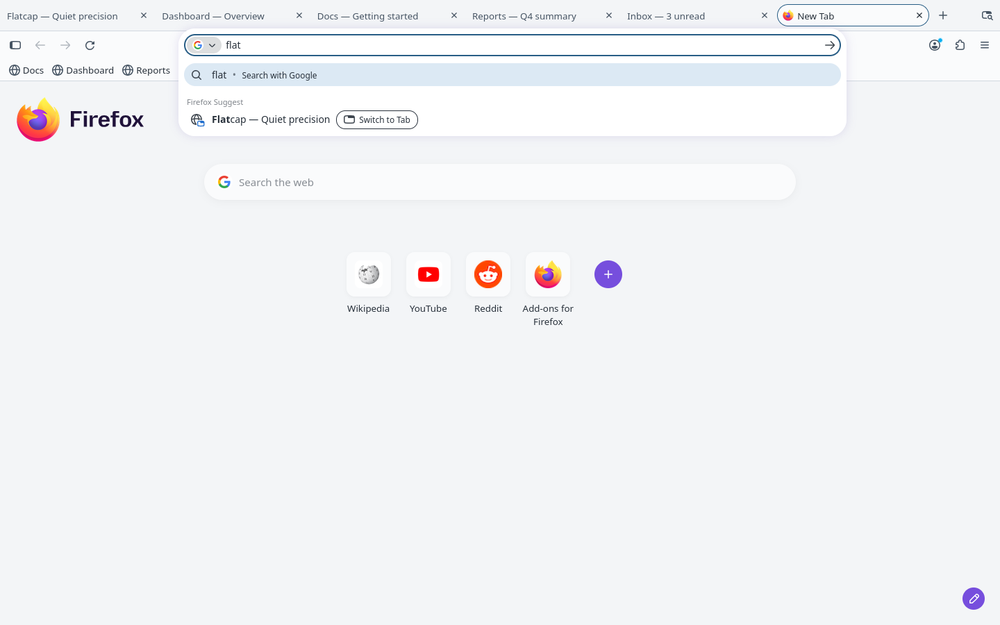

# Flatcap for Firefox

   

  

  

Flatcap Slate (dark) above, Flatcap Daylight (light) below.

**Flatcap for Firefox** brings the Flatcap visual system to the browser frame: matte graphite surfaces, one mineral-blue accent, and an interface that stays in the background.

The tab strip is the canvas, the selected tab continues the toolbar, the URL bar is recessed and the suggestions panel is the only floating layer.

> The interface organizes. Content takes the foreground. Color informs.

## Install

Install **Flatcap** from [Firefox Add-ons](https://addons.mozilla.org/en-US/firefox/addon/flatcap/).

To try it from this repository instead: run `python3 scripts/build.py --package`, then open `about:debugging` > This Firefox > Load Temporary Add-on and pick `manifest.json`.

## Use it

Slate and Daylight ship in one add-on. By default the mode follows your operating system's light or dark setting, and it switches live when that setting changes. Keep Flatcap enabled as the theme in **Add-ons and themes > Themes**; there is nothing else to configure.

## Accessibility

Contrast is computed from the theme values against the contracts of the [Flatcap core](https://github.com/cheycron/flatcap-theme), and `python3 scripts/build.py --check` fails if any pair misses its target: 7:1 for primary text, 5:1 for toolbar text and icons, 3:1 for outlines and focus.

Limits that affect you:

- **Computed, not sampled.** Firefox derives some states (hover overlays, disabled items, inactive windows) itself, and web content is outside the theme.
- **Decorative edges** (popup border, selected tab against the strip) are not held to 3:1; the tab line carries the selected state.

The role mapping and the contrast table are in the [full mapping](https://github.com/cheycron/flatcap-firefox/blob/main/docs/mapping.md).

## Compatibility

- Minimum **Firefox 109** (`strict_min_version`, Manifest V3). This release was checked on Firefox **159** (Linux), in both modes and with a live mode change, and on the author's desktop Firefox. Older versions were not tested.
- `ntp_card_background` applies from Firefox 157; on 156 and earlier the URL suggestions use the popup colors. Keys an older version ignores fall back to Firefox defaults.
- Firefox for Android was not tested.

## Upgrading from v1

The add-on ID (`flatcap-theme@cheycron.com`) is unchanged, so installed copies update in place. v1 was a single dark Nord-like palette; it is now Slate, and a Daylight mode appears when Firefox is in light mode.

## Contributing

`manifest.json` is generated from `src/theme.json`; do not edit it by hand. Run `python3 scripts/build.py --check` before opening a pull request. Mapping details are in [docs/mapping.md](https://github.com/cheycron/flatcap-firefox/blob/main/docs/mapping.md).

## License

MIT © Cheycron Blaine. See [LICENSE](https://github.com/cheycron/flatcap-firefox/blob/main/LICENSE). The cap drawing in the icon derives from third-party artwork (Vexels, [terms](https://vexels.com/terms-and-conditions/)) and is not relicensed by MIT.

## Support

If Flatcap makes your workspace calmer, you can support its development.

  

