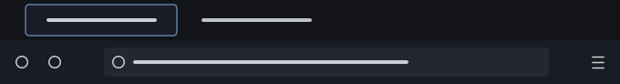
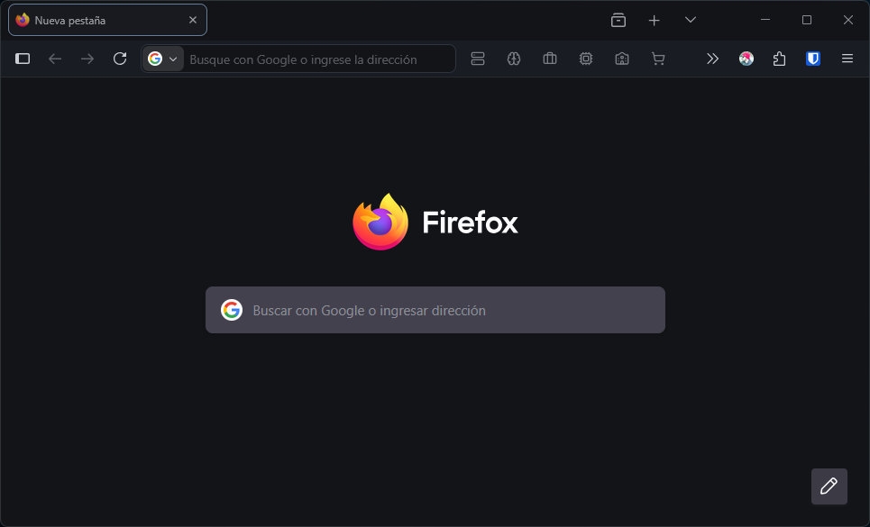

# [Flatcap](https://github.com/cheycron/flatcap-theme) for Firefox

 

**[Flatcap](https://github.com/cheycron/flatcap-theme)** is a design system and color scheme tailored for application interfaces, code editors, and data-dense dashboards. Drawing inspiration from the *Nord theme*, it embraces principles of calm, clean aesthetics, and a dimmed pastel color approach to reduce eye strain during long browsing sessions.

  

  

## 🚀 How to Install

### 🦊 Official Firefox Add-on
You can install the theme directly from the official store:
**[Install Flatcap on Firefox Add-ons](https://addons.mozilla.org/en-US/firefox/addon/flatcap/)**

### Manual Installation (Development Mode)

1.  **Open Debugging**: Type `about:debugging` in your Firefox address bar and press Enter.
2.  **Select Context**: Click on **This Firefox** in the left sidebar.
3.  **Load Temporary Add-on**: Click the **Load Temporary Add-on...** button.
4.  **Select File**: Navigate to this folder and select the `manifest.json` file.

---

## 🎨 Philosophy & Design

**[Flatcap](https://github.com/cheycron/flatcap-theme)** draws inspiration from the *Nord theme*, embracing principles of calm, clean aesthetics, and a dimmed pastel color approach.

### Color Palette

The system relies on **20 core colors** divided into four distinct families.

| Family | Description |
| :--- | :--- |
| **Deep Twilight** | Structural foundation. Deep, matte backgrounds (`#121418`) to create focus. |
| **Dawnlight** | Typography hierarchy. From muted metadata (`#b2b6bf`) to crisp body text (`#cbced5`). |
| **Ocean Blues** | Primary interaction. Calming blues (`#81a1c1`) for actions and navigation. |
| **Vivid Accents** | Semantic feedback. Desaturated accents for errors (`#bf616a`) and success (`#a3be8c`). |

## ✒️ Typography & Fonts

While Firefox themes primarily affect the UI colors, for the best visual experience in the browser interface, we recommend having these fonts installed on your system:

*   **[Inter](https://fonts.google.com/specimen/Inter)** (UI & Text)
*   **[Cascadia Code NF](https://github.com/microsoft/cascadia-code/releases)** (Code & Monospace)

---

  Distributed under the MIT License.

  

